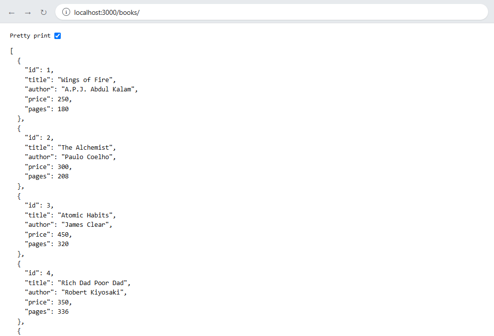
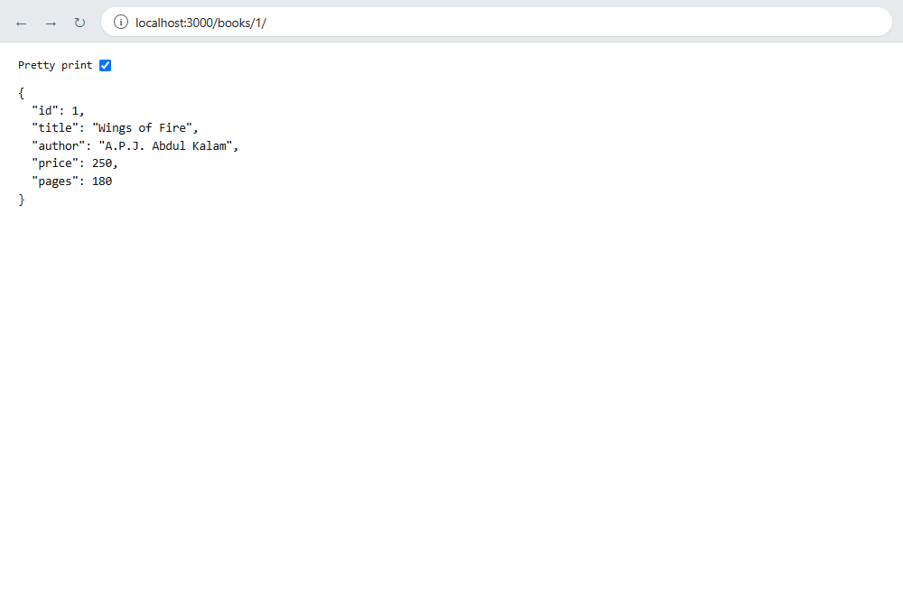
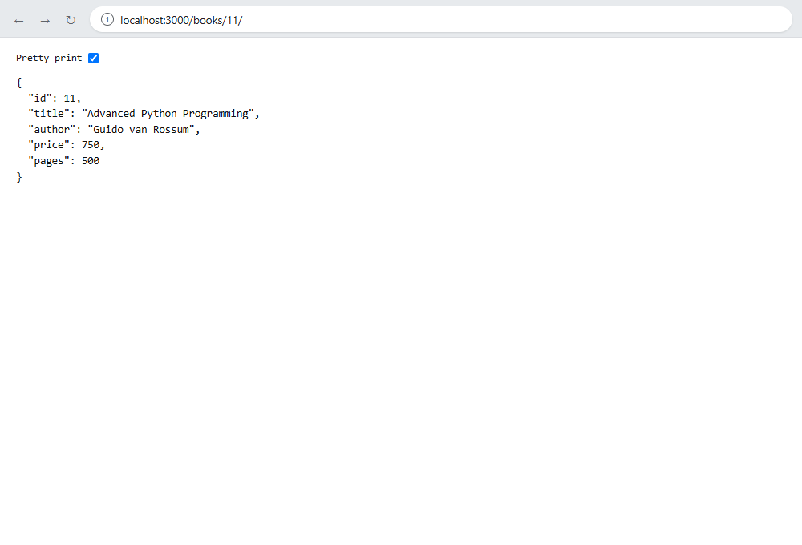

# Lab 2: SQLite Database and CRUD Routes

## Student Details

* **Name:** Talakonda Bharath
* **Registration Number:** 252U1R9156
* **Section:** CSE-GAI-2C

---

## Objective

The objective of this lab is to connect an Express.js server with an SQLite database and perform CRUD (Create, Read, Update, Delete) operations through HTTP routes.

## Technologies Used

* Node.js
* Express.js
* SQLite
* sqlite3
* sqlite
* Nodemon
* JavaScript

## Project Structure

```text
lab-02/
│
├── screenshots/
│   ├── get-all-books.png
│   ├── get-book-by-id.png
│   ├── post-add-book.png
│   ├── put-update-book.png
│   └── delete-book.png
│
├── node_modules/
├── bookStore.db
├── package.json
├── package-lock.json
├── server.js
└── README.md
```

## Database Details

**Database Name:** `bookStore.db`  
**Table Name:** `book`

The `book` table contains the following schema:

| Column | Data Type | Constraint |
| :--- | :--- | :--- |
| `id` | INTEGER | PRIMARY KEY AUTOINCREMENT |
| `title` | TEXT | NOT NULL |
| `author` | TEXT | NOT NULL |
| `price` | INTEGER | NOT NULL |
| `pages` | INTEGER | NOT NULL |

Initially, 10 book records are seeded into the database:

1. **Wings of Fire** by A.P.J. Abdul Kalam (Price: ₹250, Pages: 180)
2. **The Alchemist** by Paulo Coelho (Price: ₹300, Pages: 208)
3. **Atomic Habits** by James Clear (Price: ₹450, Pages: 320)
4. **Rich Dad Poor Dad** by Robert Kiyosaki (Price: ₹350, Pages: 336)
5. **The Guide** by R.K. Narayan (Price: ₹200, Pages: 220)
6. **Harry Potter** by J.K. Rowling (Price: ₹500, Pages: 400)
7. **Think Like a Monk** by Jay Shetty (Price: ₹400, Pages: 288)
8. **Ikigai** by Hector Garcia (Price: ₹299, Pages: 194)
9. **Deep Work** by Cal Newport (Price: ₹375, Pages: 296)
10. **The Discovery of India** by Jawaharlal Nehru (Price: ₹550, Pages: 600)

## Installation and Execution

### 1. Install dependencies

```bash
npm install
```

### 2. Start the server

```bash
npm start
```

Or for development with automatic reload on changes:

```bash
npm run dev
```

### 3. Server URL

```text
http://localhost:3000
```

The server automatically initializes the SQLite database connection before listening for incoming HTTP requests.

---

## API Endpoints & Documentation

### 1. GET - Retrieve All Books

* **Method:** `GET`
* **Endpoint:** `/books/`
* **Description:** Retrieves all book records from the database.
* **Success Status Code:** `200 OK`
* **Example Request:**
  ```bash
  curl -X GET http://localhost:3000/books/
  ```

**Screenshot Placeholder:**



---

### 2. GET - Retrieve a Specific Book by ID

* **Method:** `GET`
* **Endpoint:** `/books/:bookId/`
* **Description:** Retrieves the details of a particular book using its unique ID.
* **Success Status Code:** `200 OK`
* **Error Status Code:** `404 Book Not Found`
* **Example Request:**
  ```bash
  curl -X GET http://localhost:3000/books/1/
  ```

**Screenshot Placeholder:**



---

### 3. POST - Add a New Book

* **Method:** `POST`
* **Endpoint:** `/books/`
* **Description:** Inserts a new book into the database.
* **Success Status Code:** `201 Created`
* **Success Response:** `Book Added Successfully`
* **Request Headers:** `Content-Type: application/json`
* **Request Body:**
  ```json
  {
    "title": "Python Programming",
    "author": "Guido van Rossum",
    "price": 600,
    "pages": 450
  }
  ```
* **Example Request:**
  ```bash
  curl -X POST http://localhost:3000/books/ \
    -H "Content-Type: application/json" \
    -d "{\"title\":\"Python Programming\",\"author\":\"Guido van Rossum\",\"price\":600,\"pages\":450}"
  ```

**Screenshot Placeholder:**


---

### 4. PUT - Update an Existing Book

* **Method:** `PUT`
* **Endpoint:** `/books/:bookId/`
* **Description:** Updates the details of an existing book using its unique ID.
* **Success Status Code:** `200 OK`
* **Success Response:** `Book Updated Successfully`
* **Error Status Code:** `404 Book Not Found`
* **Request Headers:** `Content-Type: application/json`
* **Request Body:**
  ```json
  {
    "title": "Wings of Fire (Special Edition)",
    "author": "A.P.J. Abdul Kalam",
    "price": 320,
    "pages": 180
  }
  ```
* **Example Request:**
  ```bash
  curl -X PUT http://localhost:3000/books/1/ \
    -H "Content-Type: application/json" \
    -d "{\"title\":\"Wings of Fire (Special Edition)\",\"author\":\"A.P.J. Abdul Kalam\",\"price\":320,\"pages\":180}"
  ```

**Screenshot Placeholder:**



---

### 5. DELETE - Remove a Book

* **Method:** `DELETE`
* **Endpoint:** `/books/:bookId/`
* **Description:** Deletes a specific book from the database using its ID.
* **Success Status Code:** `200 OK`
* **Success Response:** `Book Deleted Successfully`
* **Error Status Code:** `404 Book Not Found`
* **Example Request:**
  ```bash
  curl -X DELETE http://localhost:3000/books/1/
  ```

**Screenshot Placeholder:**


---

## SQL Query Parameterization

All queries handling dynamic client input utilize parameterized placeholders (`?`). This separates SQL code from data, completely neutralizing SQL injection risks and guaranteeing safe, robust database interactions.

## Testing and Verification

All 5 CRUD API endpoints have been tested and verified:
1. `GET /books/` successfully retrieved the array of all 10 books in JSON format.
2. `GET /books/1/` returned the specific book record (`Wings of Fire`), and non-existent IDs returned `404 Book Not Found`.
3. `POST /books/` inserted a new book into the database returning `201 Book Added Successfully`.
4. `PUT /books/:bookId/` successfully updated the specified record returning `200 Book Updated Successfully`.
5. `DELETE /books/:bookId/` successfully removed the specified book record returning `200 Book Deleted Successfully`.

## Conclusion

Through this lab, I successfully connected an Express.js application with an SQLite database and implemented full CRUD capabilities via RESTful HTTP routes using asynchronous database drivers and parameterized SQL statements.
