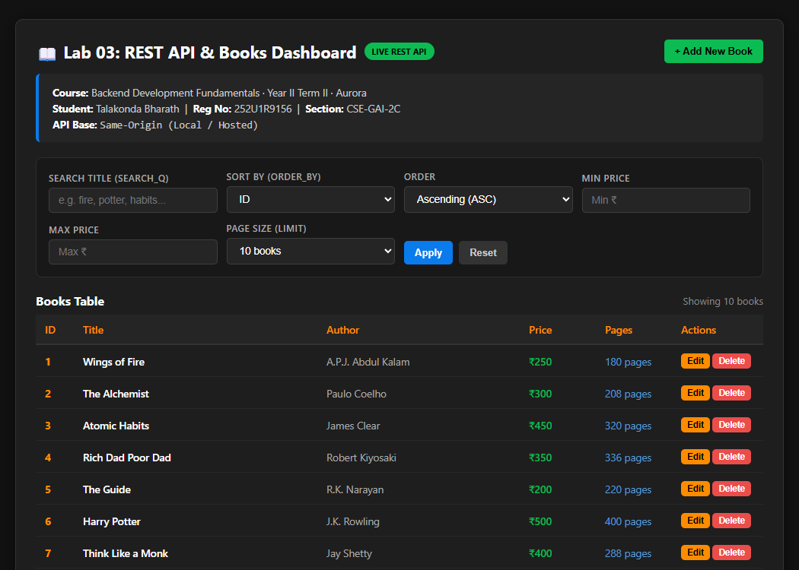
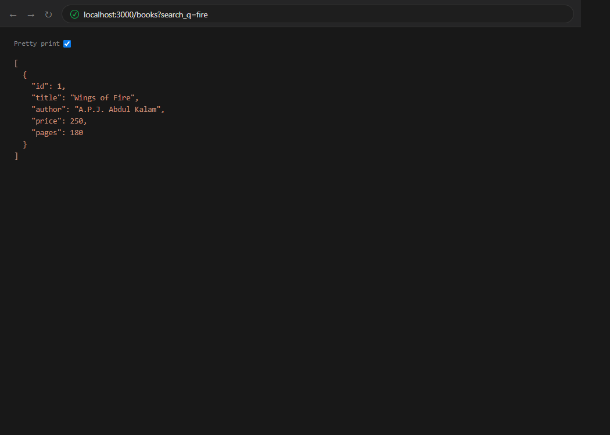
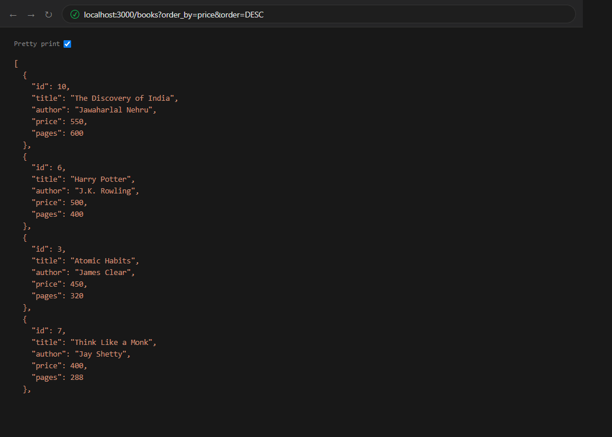
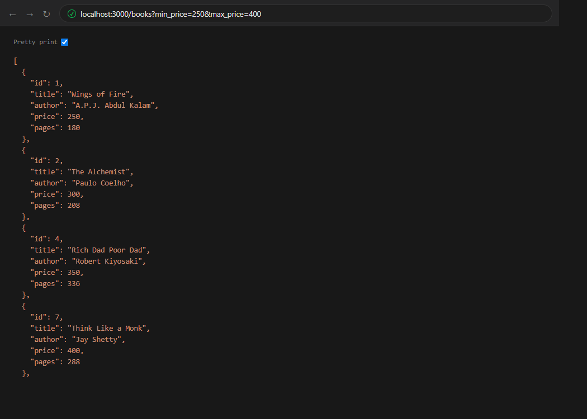
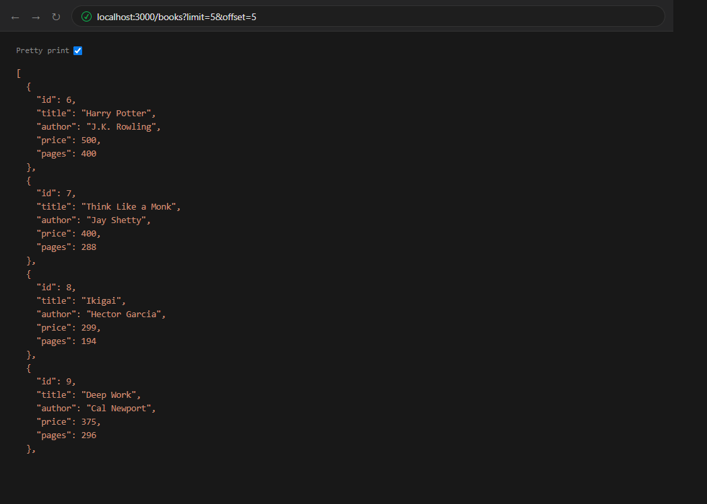
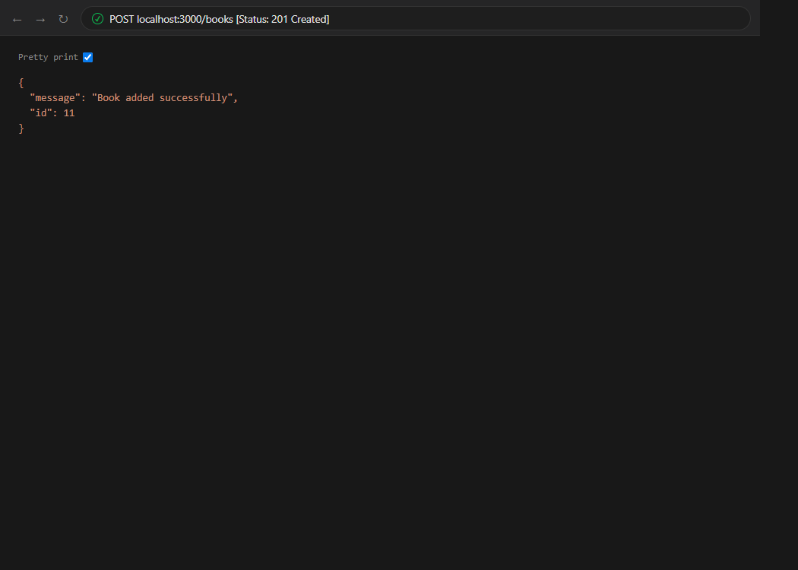
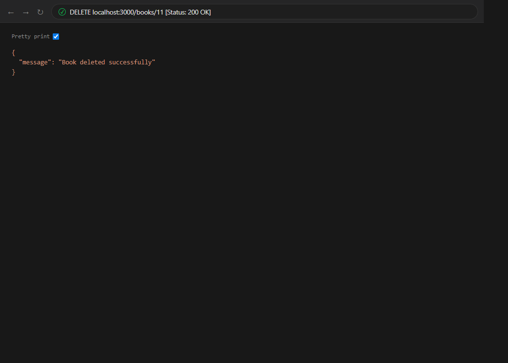
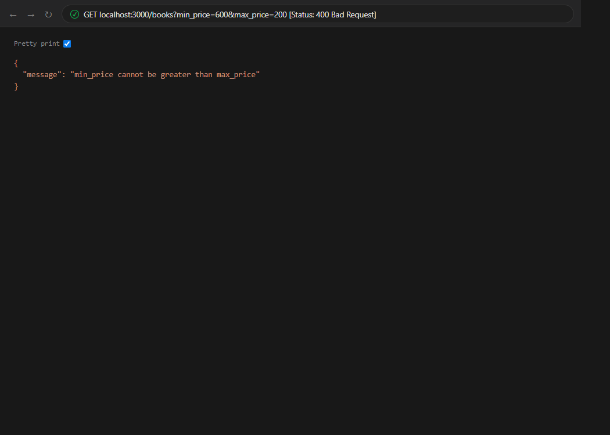
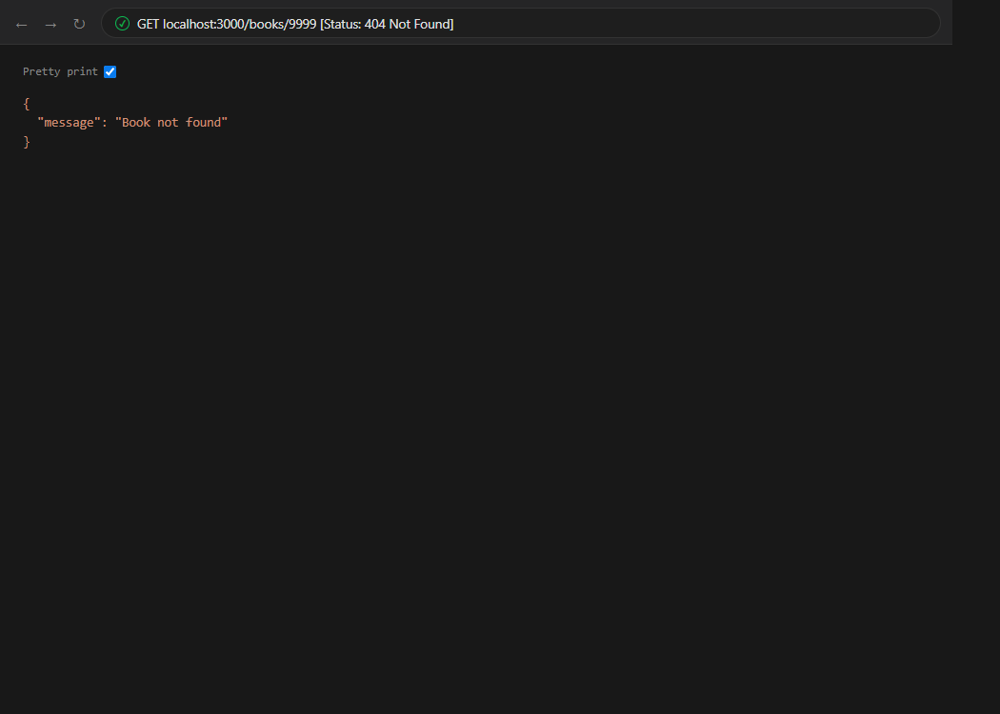

# Lab 3: REST API, Query Parameters, Validation, and Debugging

## Student Details

* **Name:** Talakonda Bharath
* **Registration Number:** 252U1R9156
* **Section:** CSE-GAI-2C

---

## Live Links & Previous Submissions

* **Live Deployment Base:** [https://lab-02-lyart.vercel.app](https://lab-02-lyart.vercel.app)
* **Lab 01 Submission:** [View Lab 1 README](../lab-01/README.md) · [Live Route](https://lab-02-lyart.vercel.app/about)
* **Lab 02 Submission:** [View Lab 2 README](../lab-02/README.md) · [Live Route](https://lab-02-lyart.vercel.app/books/)
* **Lab 03 Deployment Status:** Ready for production deployment on Vercel / Render / Railway (Local development & test verification 100% completed).

---

## Objective

Build on the foundational SQLite database and Express server from Lab 2 and Lab 1 to implement a clean, production-grade RESTful API. This lab introduces:
1. Dynamic **query parameters** for partial text search (`search_q`), sorting (`order_by`, `order`), price range filtering (`min_price`, `max_price`), and pagination (`limit`, `offset`).
2. Robust **request validation** for payload bodies (`POST`, `PUT`), rejecting invalid formats with standardized JSON errors (`400 Bad Request`).
3. Consistent **HTTP status codes** (`200 OK`, `201 Created`, `400 Bad Request`, `404 Not Found`, `500 Internal Server Error`).
4. Parameterized SQL queries using placeholders (`?`) and strict identifier allowlists to prevent SQL injection.
5. Systematic **debugging solutions** for common backend issues (`EADDRINUSE`, import paths, database table initialization, and missing `await`).
6. An interactive **frontend dashboard** served at `/` supporting live search, price filters, sorting, pagination, and book CRUD operations.

---

## Technologies Used

* **Runtime:** Node.js (v18+)
* **Framework:** Express.js (v5)
* **Database:** SQLite3 with `sqlite` wrapper
* **Middleware:** `cors` (Cross-Origin Resource Sharing), `express.json()`
* **Tools:** Nodemon, Postman, Puppeteer (verification & capture)
* **Language:** JavaScript (CommonJS)

---

## Project Structure

```text
lab-03/
│
├── screenshots/
│   ├── dashboard.png          # Interactive web UI with live table and controls
│   ├── search-books.png       # Title search (search_q=fire)
│   ├── sort-books.png         # Sorting (order_by=price&order=DESC)
│   ├── filter-price.png       # Price range filter (min_price=250&max_price=400)
│   ├── pagination.png         # Pagination (limit=5&offset=5)
│   ├── create-book.png        # Book creation (201 Created)
│   ├── update-book.png        # Book update (200 OK)
│   ├── delete-book.png        # Book deletion (200 OK)
│   ├── validation-error.png   # Request validation error (400 Bad Request)
│   └── not-found.png          # Non-existent book ID (404 Not Found)
│
├── .env.example               # Template environment configuration
├── .gitignore                 # Ignore node_modules, .env, and OS artifacts
├── bookStore.db               # SQLite database file with seeded books
├── package.json               # Project manifest and scripts
├── package-lock.json          # Dependency lockfile
├── postman_collection.json    # Complete Postman v2.1.0 test suite
├── server.js                  # Main Express REST API and frontend server
├── test_api.js                # Automated verification script (30 tests)
└── README.md                  # Comprehensive Lab 03 documentation
```

---

## Environment Variables

Copy `.env.example` to `.env` to customize settings:

```bash
cp .env.example .env
```

| Variable | Description | Default | Example |
| :--- | :--- | :--- | :--- |
| `PORT` | Server listening port | `3000` | `3000` |
| `API_BASE_URL` | Base API URL for frontend client | Same-origin (`""`) | `http://localhost:3000` |
| `NODE_ENV` | Application environment | `development` | `production` |

---

## Database Details

* **Database File:** `bookStore.db`
* **Table:** `book`

### Schema Definition:
```sql
CREATE TABLE IF NOT EXISTS book (
    id INTEGER PRIMARY KEY AUTOINCREMENT,
    title TEXT NOT NULL,
    author TEXT NOT NULL,
    price INTEGER NOT NULL,
    pages INTEGER NOT NULL
);
```

Initially seeded with 10 classic titles:
1. *Wings of Fire* — A.P.J. Abdul Kalam (₹250, 180 pages)
2. *The Alchemist* — Paulo Coelho (₹300, 208 pages)
3. *Atomic Habits* — James Clear (₹450, 320 pages)
4. *Rich Dad Poor Dad* — Robert Kiyosaki (₹350, 336 pages)
5. *The Guide* — R.K. Narayan (₹200, 220 pages)
6. *Harry Potter* — J.K. Rowling (₹500, 400 pages)
7. *Think Like a Monk* — Jay Shetty (₹400, 288 pages)
8. *Ikigai* — Hector Garcia (₹299, 194 pages)
9. *Deep Work* — Cal Newport (₹375, 296 pages)
10. *The Discovery of India* — Jawaharlal Nehru (₹550, 600 pages)

The database automatically self-heals: if `bookStore.db` is missing or the table is empty, `server.js` creates the table and populates the seed data on startup.

---

## Installation and Execution

### 1. Install dependencies
```bash
npm install
```

### 2. Start the server
```bash
npm start
```

For live-reloading during development:
```bash
npm run dev
```

### 3. Run automated tests
```bash
npm test
```

### 4. Access the web interface
Open your browser at:
```text
http://localhost:3000/
```

---

## Interactive Web Dashboard (`GET /`)

Accessing `/` in a browser renders an integrated web dashboard connecting student information, SQLite records, real-time search, sorting, filtering, and pagination:



---

## REST API Endpoints

| Method | Endpoint | Description | Status Codes |
| :--- | :--- | :--- | :--- |
| `GET` | `/books` | Retrieve books with search, sort, price filter & pagination | `200`, `400`, `500` |
| `GET` | `/books/:id` | Retrieve single book by ID | `200`, `404`, `500` |
| `POST` | `/books` | Create a new book record | `201`, `400`, `500` |
| `PUT` | `/books/:id` | Update an existing book record | `200`, `400`, `404`, `500` |
| `DELETE` | `/books/:id` | Delete a book record | `200`, `404`, `500` |
| `GET` | `/about` | Lab 1 compatibility: student details | `200` |
| `GET` | `/time` | Lab 1 compatibility: server timestamp | `200` |

---

## Query Parameters on `GET /books`

| Parameter | Type | Default | Description | Validation Rule |
| :--- | :--- | :--- | :--- | :--- |
| `search_q` | String | `""` | Case-insensitive partial title search | Uses `LIKE ?` with `%query%` |
| `order_by` | String | `"id"` | Field used for sorting | Allowlist: `id`, `title`, `author`, `price`, `pages` |
| `order` | String | `"ASC"` | Sort order direction | Allowlist: `ASC`, `DESC` (case-insensitive) |
| `limit` | Integer | `10` | Maximum records returned | Positive integer between `1` and `50` |
| `offset` | Integer | `0` | Number of records skipped | Non-negative integer (`>= 0`) |
| `min_price` | Number | None | Minimum price filter | Non-negative finite number |
| `max_price` | Number | None | Maximum price filter | Non-negative finite number (`>= min_price`) |

### Query Examples

#### 1. Search by Title
```bash
curl "http://localhost:3000/books?search_q=fire"
```


#### 2. Sort by Price Descending
```bash
curl "http://localhost:3000/books?order_by=price&order=DESC"
```


#### 3. Filter by Price Range (₹250 - ₹400)
```bash
curl "http://localhost:3000/books?min_price=250&max_price=400"
```


#### 4. Pagination (Limit 5, Offset 5)
```bash
curl "http://localhost:3000/books?limit=5&offset=5"
```


#### 5. Combined Advanced Query
```bash
curl "http://localhost:3000/books?search_q=the&order_by=price&order=ASC&min_price=100&max_price=600&limit=5&offset=0"
```

---

## Request Body Validation (`POST` & `PUT`)

Requests to `POST /books` and `PUT /books/:id` require a JSON payload with valid fields:

### Validation Rules:
* `title`: Non-empty string. If omitted or empty string: `400 Bad Request` with `{"message": "Title is required"}`.
* `author`: Non-empty string. If omitted or empty string: `400 Bad Request` with `{"message": "Author is required"}`.
* `price`: Non-negative finite number. If omitted, string, or negative: `400 Bad Request` with `{"message": "Price must be a non-negative number"}`.
* `pages`: Positive integer (defaults to `100` if omitted).

### Book Creation (`POST /books`)
```bash
curl -X POST http://localhost:3000/books \
  -H "Content-Type: application/json" \
  -d '{"title":"Clean Architecture","author":"Robert C. Martin","price":750,"pages":432}'
```
**Response (201 Created):**
```json
{
  "message": "Book added successfully",
  "id": 11
}
```


### Book Update (`PUT /books/:id`)
```bash
curl -X PUT http://localhost:3000/books/11 \
  -H "Content-Type: application/json" \
  -d '{"title":"Clean Architecture: A Craftsman Guide","author":"Robert C. Martin","price":800,"pages":450}'
```
**Response (200 OK):**
```json
{
  "message": "Book updated successfully"
}
```


### Book Deletion (`DELETE /books/:id`)
```bash
curl -X DELETE http://localhost:3000/books/11
```
**Response (200 OK):**
```json
{
  "message": "Book deleted successfully"
}
```


### Validation Error Handling (`400 Bad Request`)
When an invalid query parameter is provided (e.g. `min_price > max_price`):
```bash
curl "http://localhost:3000/books?min_price=600&max_price=200"
```
**Response (400 Bad Request):**
```json
{
  "message": "min_price cannot be greater than max_price"
}
```


### Resource Not Found (`404 Not Found`)
When requesting, updating, or deleting a non-existent ID:
```bash
curl http://localhost:3000/books/9999
```
**Response (404 Not Found):**
```json
{
  "message": "Book not found"
}
```


---

## Debugging Exercise: Problem Analysis & Fixes

During the development and testing of Lab 03, four common backend issues were analyzed and addressed:

### 1. `EADDRINUSE` (Address Already in Use)
* **Cause:** Attempting to start the Node server on a port (e.g. 3000) that is already bound by an existing instance of `server.js` or another service.
* **Fix:** 
  1. Configured port binding dynamically: `const PORT = process.env.PORT || 3000;`.
  2. Added an explicit `error` event listener on the server instance:
     ```javascript
     server.on("error", (err) => {
         if (err.code === "EADDRINUSE") {
             console.error(`Port ${PORT} is in use. Choose another port with PORT=<port> npm start`);
             process.exit(1);
         }
     });
     ```

### 2. Wrong Import Path & Module Casing
* **Cause:** Operating systems like Linux (used in cloud deployment) are strictly case-sensitive. Importing `./BookStore.db` or `Sqlite3` on Windows might succeed locally but crashes in production with `MODULE_NOT_FOUND` or `ENOENT`.
* **Fix:** Standardized all imports to lowercase exact filenames and used absolute path resolution via `path.join(__dirname, "bookStore.db")` instead of relative string concatenation.

### 3. `SQLITE_ERROR: no such table: book`
* **Cause:** Running the application on a fresh deployment without prior database migration or manual SQLite setup leads to database queries executing before the table exists.
* **Fix:** Implemented an idempotent schema initialization step inside `initializeDBAndServer()`:
  ```javascript
  await db.exec(`
      CREATE TABLE IF NOT EXISTS book (
          id INTEGER PRIMARY KEY AUTOINCREMENT,
          title TEXT NOT NULL,
          author TEXT NOT NULL,
          price INTEGER NOT NULL,
          pages INTEGER NOT NULL
      );
  `);
  ```
  Followed by an automatic record count check that seeds the 10 reference books if the table is empty.

### 4. Missing `await` on Asynchronous Database Calls
* **Cause:** Omitting `await` before asynchronous sqlite operations (such as `db.all()`, `db.run()`, or `db.get()`) causes the route handler to send a pending `Promise` object rather than resolved database rows, or creates race conditions where responses are sent before updates are written.
* **Fix:** Wrapped all database operations in `async/await` syntax with comprehensive `try/catch` blocks, ensuring errors return clean `500 Internal server error` responses without unhandled promise rejections.

---

## Postman Test Collection

A complete Postman collection is included in [`postman_collection.json`](./postman_collection.json).

### How to Import and Run:
1. Open Postman.
2. Click **Import** (top left) and select `lab-03/postman_collection.json`.
3. Set the environment variable `baseUrl` to `http://localhost:3000` (or your deployed URL).
4. Run the collection runner to execute all **Success Cases** (13 requests) and **Failure & Validation Cases** (12 requests).

---

## Deployment Guide

### Deploying to Vercel
1. Ensure the root repository contains a `vercel.json` if building serverless functions, or deploy the express server using Render / Railway.
2. In the hosting platform settings, configure:
   * **Build Command:** `npm install`
   * **Start Command:** `npm start`
   * **Environment Variables:** `PORT=3000`, `NODE_ENV=production`
3. Verify the deployment by testing `GET /books` and checking the interactive UI at `/`.

---

## Conclusion

Lab 03 delivers a fully integrated, tested RESTful API with search, sorting, filtering, pagination, robust payload validation, and an interactive web dashboard. All endpoints maintain backwards compatibility with Lab 1 and Lab 2 while providing standardized JSON responses and secure parameterized database interactions.
